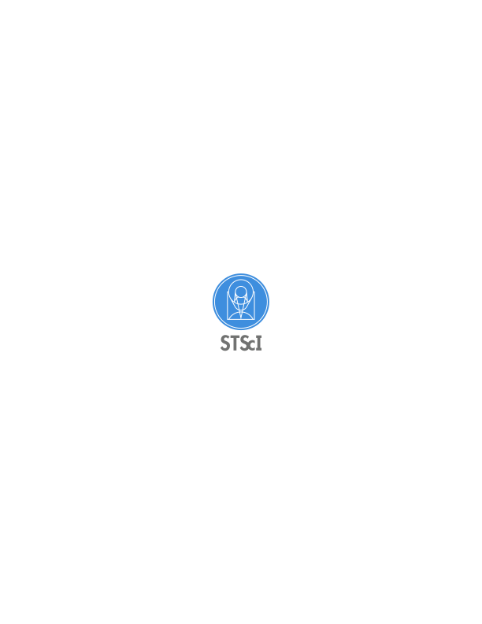
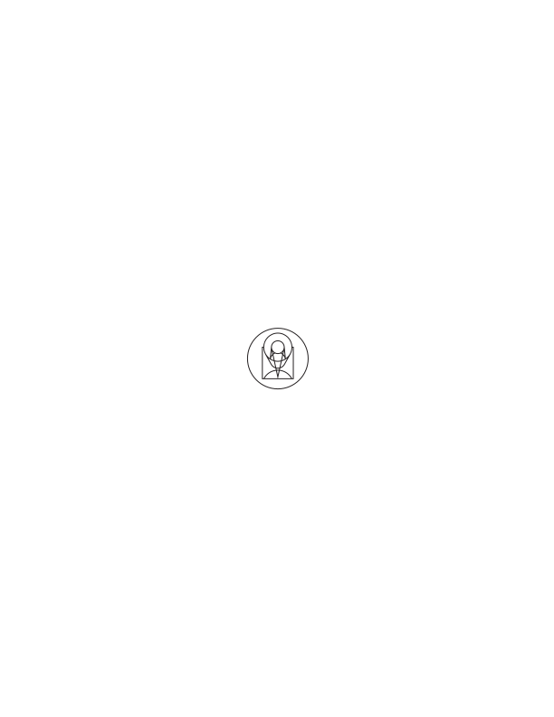
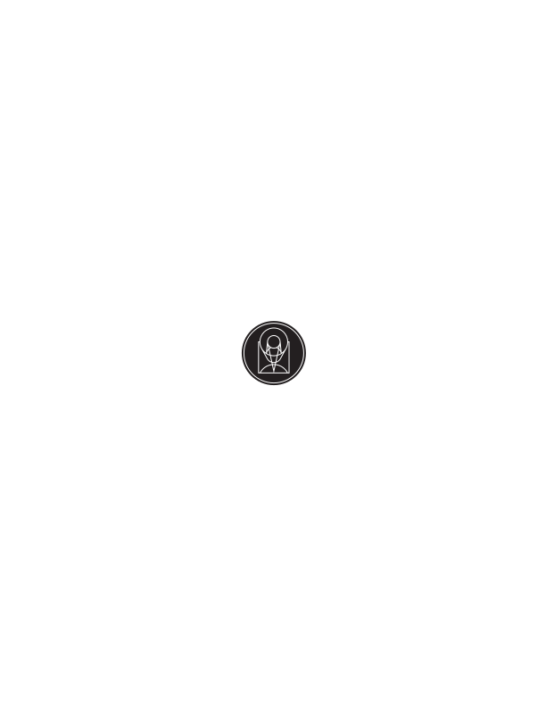

# STScI Branding

STScI brandmarks copied from Innerspace so public software docs can use them

The following examples in this README demonstrate using the HTML `picture` element
to provide light / dark alternatives dynamically, based on `prefers-color-scheme`,
[as described in the GitHub blog post](https://github.blog/developer-skills/github/how-to-make-your-images-in-markdown-on-github-adjust-for-dark-mode-and-light-mode/).

For instance, the primary combination mark can be displayed in HTML (and thus in Markdown) as follows:
```html
<picture>
  <source media="(prefers-color-scheme: dark)" srcset="./stsci_pri_combo_mark_dark_bkgd.svg">
  <source media="(prefers-color-scheme: light)" srcset="./stsci_pri_combo_mark_light_bkgd.svg">
  
</picture>
```

## Primary Combination Mark

<picture>
  <source media="(prefers-color-scheme: dark)" srcset="./stsci_pri_combo_mark_dark_bkgd.svg">
  <source media="(prefers-color-scheme: light)" srcset="./stsci_pri_combo_mark_light_bkgd.svg">
  
</picture>

## Primary Combination Mark (Horizontal)

> [!CAUTION]
> These filenames are spelled `_horizonal_` instead of `_horizontal_`.

<picture>
  <source media="(prefers-color-scheme: dark)" srcset="./stsci_pri_combo_mark_horizonal_dark_bkgd.svg">
  <source media="(prefers-color-scheme: light)" srcset="./stsci_pri_combo_mark_horizonal_light_bkgd.svg">
  
</picture>

## Secondary Combination Mark

<picture>
  <source media="(prefers-color-scheme: dark)" srcset="./stsci_sec_combo_mark_dark_bkgd.svg">
  <source media="(prefers-color-scheme: light)" srcset="./stsci_sec_combo_mark_light_bkgd.svg">
  
</picture>

## Secondary Combination Mark (Horizontal)

> [!CAUTION]
> These filenames are spelled `_horizonal_` instead of `_horizontal_`.

<picture>
  <source media="(prefers-color-scheme: dark)" srcset="./stsci_sec_combo_mark_horizonal_dark_bkgd.svg">
  <source media="(prefers-color-scheme: light)" srcset="./stsci_sec_combo_mark_horizonal_light_bkgd.svg">
  
</picture>

## Wordmark

<picture>
  <source media="(prefers-color-scheme: dark)" srcset="./stsci_wordmark_white.svg">
  <source media="(prefers-color-scheme: light)" srcset="./stsci_wordmark_black.svg">
  
</picture>

## Symbol




